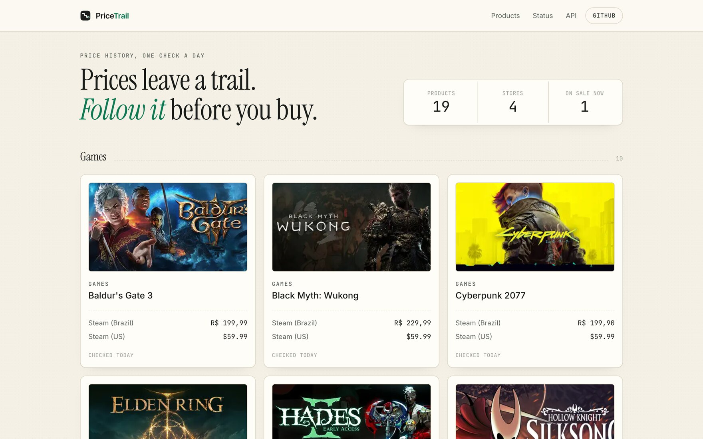
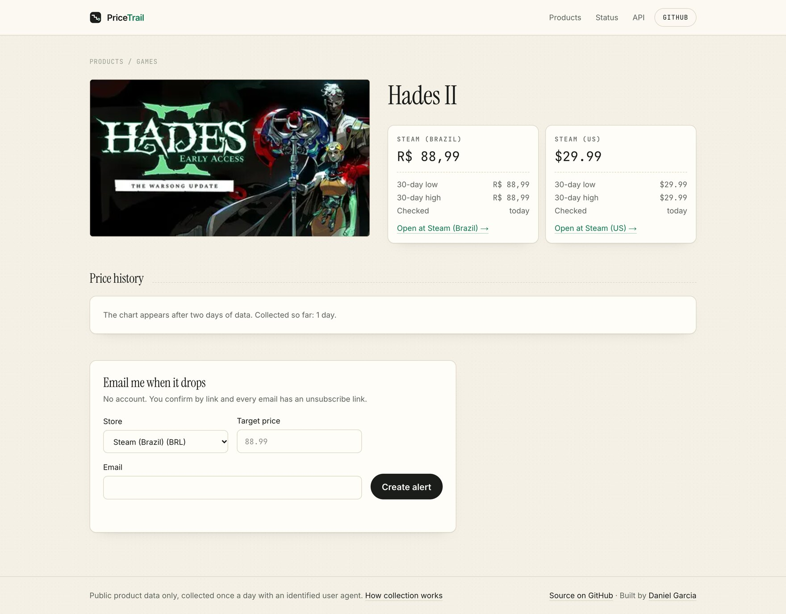
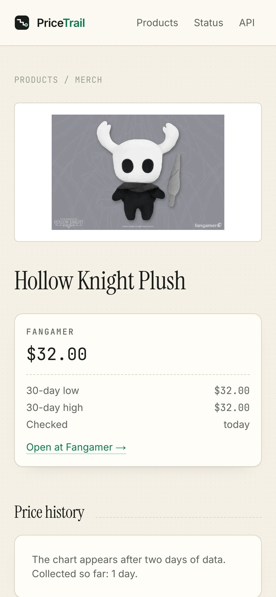
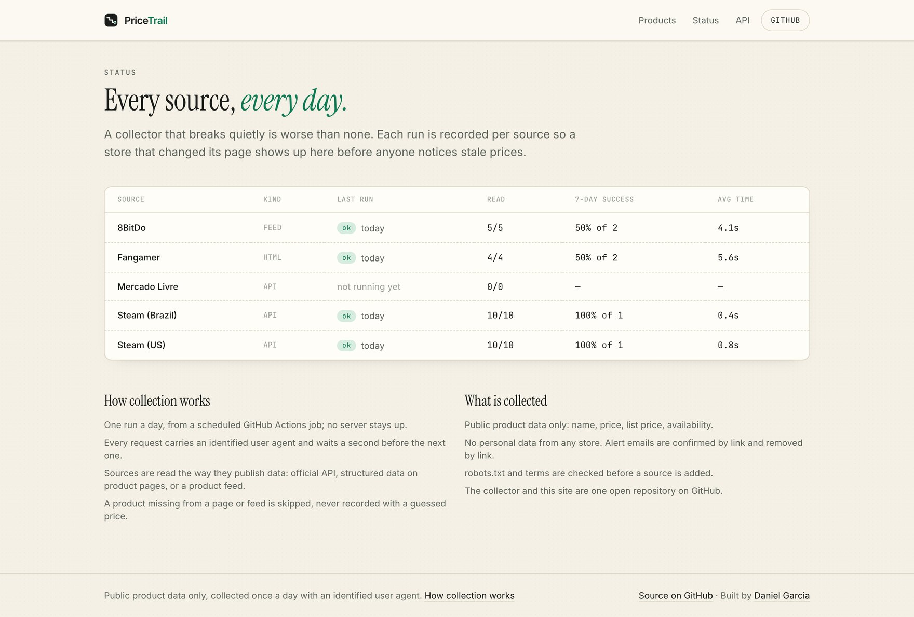
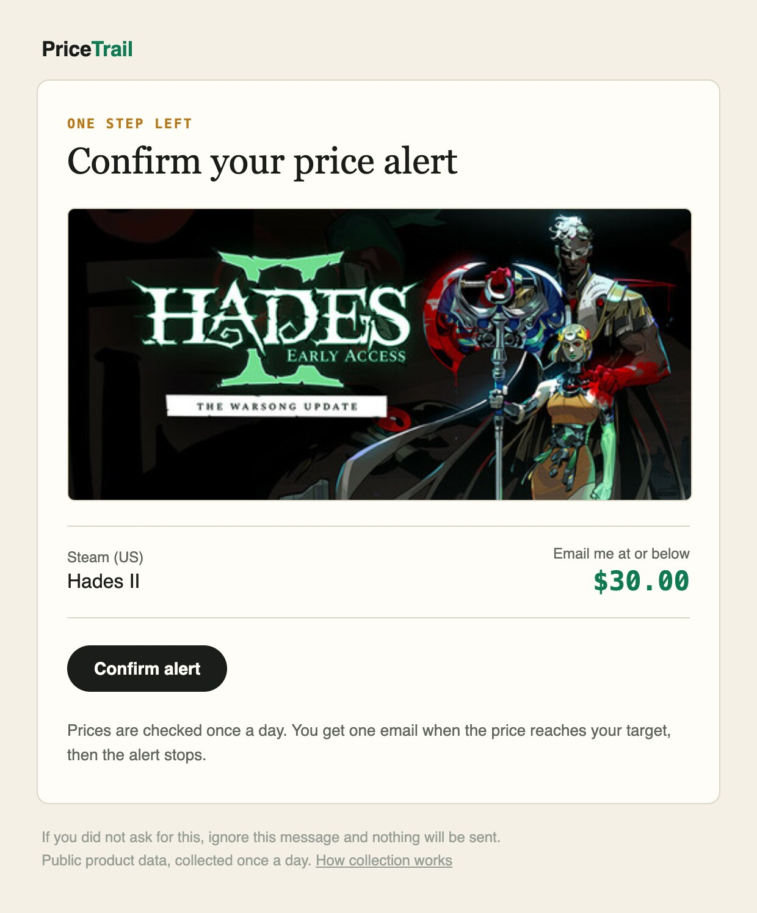
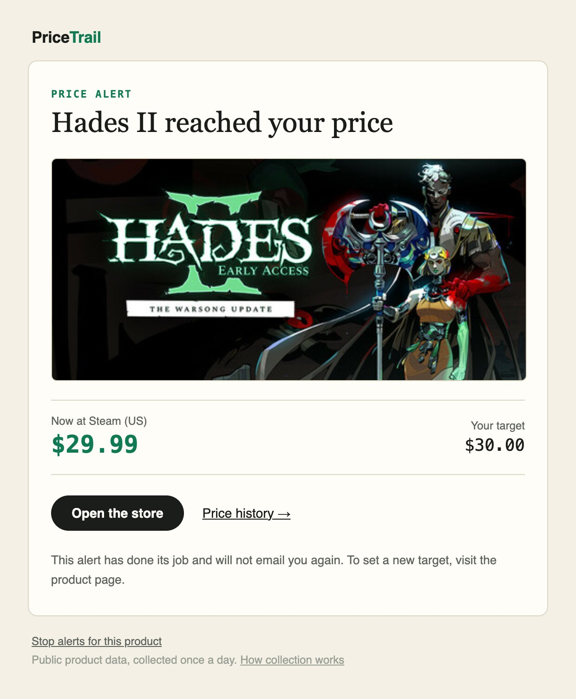

# PriceTrail

**Prices leave a trail. Follow it before you buy.**

PriceTrail checks the price of games, merch and hardware in several stores once
a day, keeps the history of every offer, and emails you when a product reaches
the price you asked for. A public status page shows whether each store was read
successfully, so a broken collector never fails silently.

**Live:** [pricetrail.danielgcravo.com](https://pricetrail.danielgcravo.com) ·
[Status](https://pricetrail.danielgcravo.com/status) ·
[API](https://pricetrail.danielgcravo.com/api)



It is also a working example of the data pipelines I build for clients: one
collector per source, parsing tested against saved responses, retries and rate
limits, every run recorded, and the result served as a site, an API and email.

## What it does

- **Daily prices from four kinds of source.** An official API, a public JSON
  storefront, product pages with structured data, and an Atom product feed.
- **Price history per offer.** The same game on Steam Brazil and Steam US is
  tracked side by side, with the 30-day low and high.
- **Email alerts without accounts.** Pick a store and a target price, confirm by
  link, get one email when the price gets there. Every email can be stopped by
  link.
- **A status page.** Last run, offers read, 7-day success rate and average time
  for every source.
- **A read-only JSON API** with the same data the pages show.
- **No server to keep alive.** Collection runs on a GitHub Actions schedule; the
  site is static where it can be and refreshed right after each run.

## Screenshots

| Product page | On a phone |
|---|---|
|  |  |



### The emails

Two emails, both in the site's look, with a plain-text version alongside for
clients that prefer it. The first confirms the alert; the second arrives once,
when the price reaches the target.

| Confirmation | Price alert |
|---|---|
|  |  |

The product and current price are real; the $30.00 target is an example.

## How it works

```
catalog.toml ──seed──▶ PostgreSQL ◀──collect── sources: API (Steam, Mercado Livre)
                          │                        ▲       HTML (Fangamer)
                          │                        │       feed (8BitDo)
                          │                        └── GitHub Actions, daily cron
                          │                            (collect → notify → revalidate site)
                          └──▶ web/ (Next.js): catalog, price charts, status, JSON API, alerts
```

- **Sources** (`src/pricetrail/sources/`) implement one method, `fetch(offers)`,
  and keep parsing in pure functions so it can be tested offline.
- **Collector** (`src/pricetrail/collect.py`) runs every source, stores one
  price point per offer, and records the outcome of each run in `runs`.
- **Schema** (`migrations/`) is plain SQL applied in order by `pricetrail migrate`.
- **Alerts** (`src/pricetrail/notify.py`) run after each collection: every
  confirmed alert whose target was reached gets one email, then stays marked.
- **Scheduling** is a GitHub Actions cron (`.github/workflows/collect.yml`).
- **Site** (`web/`) is a Next.js app that reads the same database: catalog,
  per-product history chart and 30-day range, status page built on the
  `source_status` view, the JSON API, and the alert form.

### Sources

| Source | Kind | Credentials |
|---|---|---|
| Steam (Brazil, US) | Public storefront JSON | none |
| Mercado Livre | Official API | `ML_CLIENT_ID` / `ML_CLIENT_SECRET` (app registered at developers.mercadolivre.com.br); skipped when absent |
| Fangamer | Product pages, schema.org microdata | none |
| 8BitDo | Atom product feed | none |

The HTML source (`sources/html.py`) reads schema.org `Product` offers from
either JSON-LD or microdata, so it works unchanged on any store that publishes
structured data. The feed source (`sources/feed.py`) reads the Shopify-style
Atom feed that many stores expose at `/collections/all.atom`.

Each run is recorded per source (status, offers read, duration, error); the
`source_status` view summarises the last run and the success rate of the past
seven days, which is what `pricetrail status` prints and the status page shows.

### The API

```sh
curl -s https://pricetrail.danielgcravo.com/api/products              # every product, latest prices
curl -s https://pricetrail.danielgcravo.com/api/products/elden-ring   # one product with its history
curl -s https://pricetrail.danielgcravo.com/api/status                # health of each source
```

Responses are cached for five minutes. Please keep it to a few requests a minute.

## Collection ethics

- Only public product data: names, prices, availability. No personal data.
- Identified `User-Agent`, one request per second, batches where the source
  allows them, and at most one run per day.
- `robots.txt` and terms of service are checked before a source is added
  (the two Shopify stores state that public product pages are crawlable).
- Failures back off exponentially; a source that keeps failing is skipped for
  the day, never retried in a loop.

## Stack

- **Collector:** Python 3.12, httpx, psycopg 3; pytest and ruff.
- **Site:** Next.js 16 (App Router, Cache Components), React 19, Tailwind CSS 4,
  postgres.js. The chart is plain SVG.
- **Data and delivery:** PostgreSQL (Neon), Resend for email, Vercel for the
  site, GitHub Actions for the schedule and CI.

## Running locally

```sh
docker compose up -d db                  # PostgreSQL on localhost:5433
python3 -m venv .venv && source .venv/bin/activate
pip install -e ".[dev]"
cp .env.example .env                     # then export the variables
pricetrail migrate                       # apply migrations
pricetrail seed                          # load catalog.toml
pricetrail collect                       # fetch today's prices
pricetrail status                        # last run of each source
pytest                                   # unit + database tests
```

### The site

```sh
cd web
npm install
cp .env.example .env.local                # DATABASE_URL, RESEND_API_KEY, REVALIDATE_SECRET…
npm run dev -- -p 3001
```

Pages are cached and refreshed by tag: after each run the collector workflow
calls `POST /api/revalidate` with the shared secret, so the first visit after a
collection already sees the new prices. Without `RESEND_API_KEY` the emails are
printed to the server log.

## Deploying

1. Create a PostgreSQL database (Neon's free tier works) and run
   `pricetrail migrate` and `pricetrail seed` against it.
2. Add `DATABASE_URL`, `RESEND_API_KEY` and `REVALIDATE_SECRET` (and optionally
   the Mercado Livre keys) as repository secrets, and `SITE_URL` / `ALERT_FROM`
   as repository variables.
3. Deploy `web/` to Vercel with the same `DATABASE_URL` (the pooled connection
   string), `RESEND_API_KEY`, `REVALIDATE_SECRET`, `ALERT_FROM` and
   `NEXT_PUBLIC_SITE_URL`.
4. The `Collect prices` workflow runs daily at 09:17 UTC; trigger it manually
   from the Actions tab for the first run.

## Roadmap

- [x] Phase 1: schema, collector, Steam and Mercado Livre sources, daily cron
- [x] Phase 2: HTML and feed sources, status data
- [x] Phase 3: web app (catalog, price charts, email alerts, read-only API)
- [x] Phase 4: live at pricetrail.danielgcravo.com, HTML emails, documentation

## License

MIT
